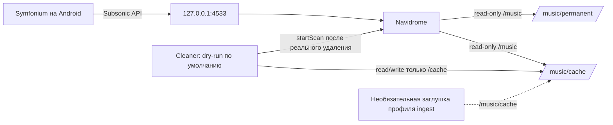

# selfhosted-music

Домашний сервер музыки на Navidrome с библиотекой для Symfonium и отдельным
очистителем временного кэша. Очиститель видит только `MUSIC_ROOT/cache`; каталог
`permanent` в его контейнер не монтируется.

## Архитектура



`Navidrome` и `cleaner` работают в закрытой Docker-сети. На хост публикуется
только порт Navidrome; по умолчанию он привязан к `127.0.0.1`. Профиль `ingest`
выключен и содержит только безопасную заглушку — загрузчика и секретов в репозитории нет.

## Что куда монтируется

Пути слева — реальные пути на домашнем компьютере из `.env`, справа — пути
внутри контейнеров:

| Сервис | Путь на хосте | Путь в контейнере | Доступ |
|---|---|---|---|
| Navidrome: музыка | `${MUSIC_ROOT}` | `/music` | Только чтение; содержит `permanent/` и `cache/` |
| Navidrome: база и состояние | `${NAVIDROME_DATA}` | `/data` | Чтение и запись |
| Cleaner | `${MUSIC_ROOT}/cache` | `/cache` | Чтение и запись; `permanent/` контейнеру не монтируется |
| Ingest-заглушка | `${MUSIC_ROOT}/cache` | `/music/cache` | Только при явном включении профиля `ingest` |

Navidrome и cleaner запускаются с числовыми `PUID:PGID`. Этот пользователь должен
читать оба музыкальных каталога, писать в `cache/` и писать в `NAVIDROME_DATA`.
Значения `1000:1000` в `.env.example` — пример, а не гарантия правильного
пользователя на конкретном сервере. Не исправляйте права рекурсивным `chown -R`
без проверки и разрешения владельца.

Значения `MUSIC_ROOT=./music` и `NAVIDROME_DATA=./data/navidrome` в примере
создают каталоги внутри клона репозитория. Это удобно для пустого тестового
запуска, но обычно для домашней библиотеки лучше выбрать отдельное место на
диске. Не переносите существующую музыку ради совпадения с примером: сначала
определите правильные пути и подтвердите план.

## Политика очистки

- Файлы старше `CACHE_MAX_AGE_DAYS` удаляются по `mtime`.
- Если кэш больше `CACHE_MAX_SIZE_GB`, удаляются самые старые подходящие файлы,
  пока размер не станет ниже лимита. Единица — GiB (`1024^3` байта).
- Файлы младше `CACHE_MIN_AGE_MINUTES`, `*.part`, `*.tmp`, symlink-и и
  не-файловые объекты не удаляются.
- Все кандидаты проверяются через `realpath` относительно корня кэша.
- `DRY_RUN=true` — значение по умолчанию. Перед реальным удалением проверьте
  кандидатов командой `make dry-run`; менять режим можно только осознанно.
- После фактического удаления очищаются пустые подпапки и вызывается Subsonic
  `startScan`. Пароль передаётся только как MD5-токен с солью; plain-пароль не
  уходит в запрос. При недоступности Navidrome cleaner пишет предупреждение и продолжает.
- Избранное Navidrome не закрепляется: опциональная функция pin не включена.

## Быстрый запуск

Нужны Docker Engine и Docker Compose v2. Скопируйте пример настроек, заполните
пути и UID/GID, создайте папки музыки и данных, затем запустите. Если это делает
домашний агент, сначала пройдите опросник ниже и согласуйте план; этот блок не
следует выполнять вслепую на сервере с уже существующими данными.

```sh
cp .env.example .env
# Отредактируйте .env: MUSIC_ROOT, NAVIDROME_DATA, PUID, PGID и TZ.
set -a
. ./.env
set +a
mkdir -p "${MUSIC_ROOT}/permanent" "${MUSIC_ROOT}/cache" "${NAVIDROME_DATA}"
make up
```

Откройте `http://127.0.0.1:4533` (или указанный `NAVIDROME_BIND_ADDRESS` и
`NAVIDROME_PORT`) и создайте администратора. Поместите тестовый MP3 в обе папки
`permanent` и `cache`, дождитесь сканирования, затем выполните:

```sh
make dry-run
```

`make dry-run` ничего не удаляет. Только после проверки вывода и осознанного
решения владельца измените `DRY_RUN=false` в локальном `.env`; этот файл
игнорируется Git.

Чтобы cleaner вызывал `startScan` после удаления, задайте в `.env`
`NAVIDROME_USER` и `NAVIDROME_PASSWORD` для учётной записи Navidrome с доступом
к сканированию. Не добавляйте `.env` в Git.

Включение заглушки загрузчика (по умолчанию выключена):

```sh
docker compose --profile ingest up -d
```

Подставляйте собственный загрузчик только после проверки его поведения и
секретов; заглушка сама ничего не скачивает.

## Команды

```sh
make up       # собрать cleaner и запустить сервисы
make down     # остановить Compose-сервисы
make logs     # смотреть логи
make dry-run  # однократный безопасный предпросмотр
make test     # pytest для cleaner
make lint     # Ruff
make config   # проверить Compose с .env.example
```

## Проверки локально

```sh
python3 -m pip install -r requirements-dev.txt
make test
make lint
make config
```

## Что домашний агент должен выяснить до установки

Сначала агент проверяет доступные ему сведения без изменений: ОС, Docker и
Compose, UID/GID выбранного пользователя, свободное место в указанных разделах
и занятость порта. Он не должен обследовать посторонние папки или читать
музыкальные файлы. Затем одним сообщением задаёт только вопросы, ответы на
которые нельзя безопасно узнать самому:

1. **Где будет клон проекта?** Путь к каталогу кода; код и пользовательские
   данные лучше держать раздельно.
2. **Где будут музыка и кэш?** Укажите один `MUSIC_ROOT`, внутри которого должны
   быть `permanent/` и `cache/`. Скажите, существуют ли эти папки и где сейчас
   лежат нужные файлы. Перемещать, копировать, переименовывать или объединять
   каталоги без отдельного согласия нельзя.
3. **Где хранить состояние Navidrome?** Укажите `NAVIDROME_DATA`; уточните,
   создаётся ли новая пустая база или нужно сохранить существующую, и есть ли
   её резервная копия.
4. **От какого пользователя запускать контейнеры?** Агент может показать
   обнаруженные UID/GID, но владелец подтверждает, что этот пользователь имеет
   нужный доступ к указанным каталогам. Не менять владельца или права без
   отдельного согласия.
5. **Откуда подключаться к музыке?** Только с домашнего компьютера, из
   домашней Wi-Fi-сети, через VPN или через HTTPS reverse proxy? Значение по
   умолчанию `127.0.0.1` недоступно телефону. Не открывать порт в firewall или
   роутере и не публиковать сервис в интернет автоматически.
6. **Подходят ли настройки?** По умолчанию порт `4533`, очистка старше 30 дней,
   предел кэша `20 GiB`, защита новых файлов `60 минут`. `DRY_RUN=true` остаётся
   включённым, пока владелец отдельно не разрешит реальные удаления.
7. **Можно ли применить согласованный план?** Перед созданием папок и `.env`,
   загрузкой образов и запуском контейнеров агент перечисляет точные пути,
   пользователя, сетевую привязку и команды и получает подтверждение.

Учётные данные Navidrome для `startScan` необязательны. Если владелец хочет
включить сканирование после удаления, агент объясняет, куда локально внести
`NAVIDROME_USER` и `NAVIDROME_PASSWORD`; он никогда не просит прислать пароль в
чат и не коммитит `.env`.

Пример ответа владельца:

```text
Каталог проекта: …
MUSIC_ROOT: …
  permanent: новая папка / уже существует, путь …
  cache: новая папка / уже существует, путь …
  перемещать существующие файлы: нет / отдельный согласованный план
NAVIDROME_DATA: …; новая база / существующие данные; резервная копия: …
Пользователь и UID:GID: …
Доступ к Symfonium: только хост / LAN / VPN / HTTPS reverse proxy
Порт: 4533 / другой …
Порог очистки: оставить значения по умолчанию / изменить …
startScan после удаления: не нужен / настрою локально в .env
Подтверждаю согласованный план установки: да / нет
```

GitHub Actions запускает тесты, Ruff и `docker compose config` на push и pull
request. Очиститель использует только Python stdlib; pytest и Ruff нужны для
разработки и CI.

## Настройки и допущения

Все пути, хостовый адрес/порт, часовой пояс и UID/GID задаются в `.env`.
`REGISTRY_PREFIX` позволяет заменить `docker.io` на зеркало. Версии Navidrome,
Python и Alpine закреплены в Compose/Dockerfile; перед обновлением тегов
проверьте совместимость и заново запустите CI. Проверка `docker compose config`
валидирует конфигурацию, но сама по себе не скачивает образы и не проверяет
домашний сервер.

Сканирование вызывается только после реального удаления. Если учётные данные
Navidrome не заданы, cleaner безопасно пропускает API-вызов. Cleaner не удаляет
symlink-и вообще; это консервативнее, чем удаление ссылки даже при внутренней
цели.
