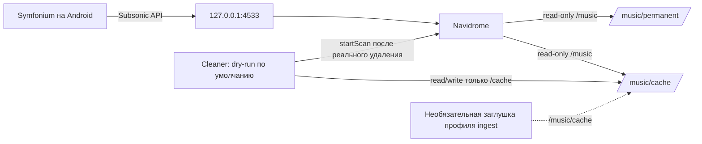

# selfhosted-music

Домашний сервер музыки на Navidrome с библиотекой для Symfonium и отдельным
очистителем временного кэша. Очиститель видит только `MUSIC_ROOT/cache`; каталог
`permanent` в его контейнер не монтируется.

## Архитектура



`Navidrome` и `cleaner` работают в закрытой Docker-сети. На хост публикуется
только порт Navidrome; по умолчанию он привязан к `127.0.0.1`. Профиль `ingest`
выключен и содержит только безопасную заглушку — загрузчика и секретов в репозитории нет.

## Политика очистки

- Файлы старше `CACHE_MAX_AGE_DAYS` удаляются по `mtime`.
- Если кэш больше `CACHE_MAX_SIZE_GB`, удаляются самые старые подходящие файлы,
  пока размер не станет ниже лимита. Единица — GiB (`1024^3` байта).
- Файлы младше `CACHE_MIN_AGE_MINUTES`, `*.part`, `*.tmp`, symlink-и и
  не-файловые объекты не удаляются.
- Все кандидаты проверяются через `realpath` относительно корня кэша.
- `DRY_RUN=true` — значение по умолчанию. Перед реальным удалением проверьте
  кандидатов командой `make dry-run`; менять режим можно только осознанно.
- После фактического удаления очищаются пустые подпапки и вызывается Subsonic
  `startScan`. Пароль передаётся только как MD5-токен с солью; plain-пароль не
  уходит в запрос. При недоступности Navidrome cleaner пишет предупреждение и продолжает.
- Избранное Navidrome не закрепляется: опциональная функция pin не включена.

## Быстрый запуск

Нужны Docker Engine и Docker Compose v2. Скопируйте пример настроек, заполните
пути и UID/GID, создайте папки музыки и данных, затем запустите:

```sh
cp .env.example .env
# Отредактируйте .env: MUSIC_ROOT, NAVIDROME_DATA, PUID, PGID и TZ.
set -a
. ./.env
set +a
mkdir -p "${MUSIC_ROOT}/permanent" "${MUSIC_ROOT}/cache" "${NAVIDROME_DATA}"
make up
```

Откройте `http://127.0.0.1:4533` (или указанный `NAVIDROME_BIND_ADDRESS` и
`NAVIDROME_PORT`) и создайте администратора. Поместите тестовый MP3 в обе папки
`permanent` и `cache`, дождитесь сканирования, затем выполните:

```sh
make dry-run
```

`make dry-run` ничего не удаляет. Только после проверки вывода и осознанного
решения владельца измените `DRY_RUN=false` в локальном `.env`; этот файл
игнорируется Git.

Чтобы cleaner вызывал `startScan` после удаления, задайте в `.env`
`NAVIDROME_USER` и `NAVIDROME_PASSWORD` для учётной записи Navidrome с доступом
к сканированию. Не добавляйте `.env` в Git.

Включение заглушки загрузчика (по умолчанию выключена):

```sh
docker compose --profile ingest up -d
```

Подставляйте собственный загрузчик только после проверки его поведения и
секретов; заглушка сама ничего не скачивает.

## Команды

```sh
make up       # собрать cleaner и запустить сервисы
make down     # остановить Compose-сервисы
make logs     # смотреть логи
make dry-run  # однократный безопасный предпросмотр
make test     # pytest для cleaner
make lint     # Ruff
make config   # проверить Compose с .env.example
```

## Проверки локально

```sh
python3 -m pip install -r requirements-dev.txt
make test
make lint
make config
```

GitHub Actions запускает тесты, Ruff и `docker compose config` на push и pull
request. Очиститель использует только Python stdlib; pytest и Ruff нужны для
разработки и CI.

## Настройки и допущения

Все пути, хостовый адрес/порт, часовой пояс и UID/GID задаются в `.env`.
`REGISTRY_PREFIX` позволяет заменить `docker.io` на зеркало. Версии Navidrome,
Python и Alpine закреплены в Compose/Dockerfile; перед обновлением тегов
проверьте совместимость и заново запустите CI. Проверка `docker compose config`
валидирует конфигурацию, но сама по себе не скачивает образы и не проверяет
домашний сервер.

Сканирование вызывается только после реального удаления. Если учётные данные
Navidrome не заданы, cleaner безопасно пропускает API-вызов. Cleaner не удаляет
symlink-и вообще; это консервативнее, чем удаление ссылки даже при внутренней
цели.
